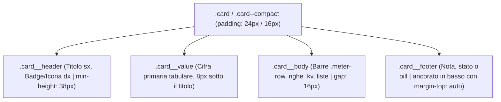

# 📐 Financial WebApp — Central Design System & Visual Specification (DESIGN.md)

> **Fonte di Verità Centralizzata (Single Source of Truth)**: Questo documento governa l'interfaccia utente, la tipografia, le scale di spaziatura, i design token, la palette semantica e l'anatomia dei componenti di tutte le pagine dell'applicazione *Finanze Personali* (Dashboard, Movimenti, Investimenti, Storico NW, Configurazione, modali e viste future), conforme alla skill `ui-perfect-design` e alle Apple Human Interface Guidelines (HIG).

---

## 🎯 1. Scopo dell'App & Tono Visivo

- **Scopo**: Suite completa di Finanza Personale, Budgeting 50/30/20 a Buste, Tracciamento Flusso di Cassa, Gestione Patrimonio Netto (Net Worth), Asset Allocation, Indipendenza Finanziaria (F.I.R.E. & PAC) e Certificazione Fiscale.
- **Tono Visivo**: *Apple Executive & High-End FinTech*. Rigore ingegneristico assoluto, estetica ispirata a Apple.com e macOS/iOS, superfici in vetro satinato (Glassmorphism), curve squircle continue, assenza di collisioni o sovrapposizioni e massima leggibilità delle cifre numeriche.
- **Risoluzioni Target**:
  - **Desktop / MacBook** (1200px – 1920px+): Sidebar sinistra fissa (270px) + Header trasparente + Viewport fluido centrato (`max-width: 1400px`).
  - **Tablet / iPad** (768px – 1024px): Griglie a 2 o 3 colonne con respiri proporzionati.
  - **Mobile / iPhone** (320px – 480px): Colonna singola, Top Bar Dynamic Island con pulsante privacy e Bottom Tab Bar nativa iOS a 5 pulsanti (`min-height: 44px`).

---

## 📏 2. Spaziature Centrali (Solo Scala a 8px / Base 4px)

È rigorosamente vietato l'utilizzo di spaziature o margini arbitrari (`margin: 13px`, `padding: 21px`). Tutte le distanze del sito appartengono unicamente a questi valori:

| Token | Valore | Regola Applicativa Immodificabile |
| :--- | :---: | :--- |
| `--space-1` | **4px** | Micro-gap, spazio tra icona badge e testo |
| `--space-2` | **8px** | **Titolo card → Valore primario**; **Etichetta → Barra di progresso**; Distanza minima assoluta tra testi |
| `--space-3` | **12px** | **Distanza minima tra etichetta e valore sulla stessa riga**; Padding top footer card |
| `--space-4` | **16px** | **Header card → Contenuto**; **Blocco → Blocco interno**; **Barra di progresso → Riga successiva**; **Padding interno card compatte** |
| `--space-5` | **24px** | **Gap tra card (orizzontale e verticale)**; **Stacco tra sezioni identico ovunque**; **Padding interno di ogni card standard**; **Clearance contenuto sotto l'header (`padding-top: 24px`)** |
| `--space-6` | **32px** | Margini laterali visuali desktop; Distacco macro-blocchi |
| `--space-7` | **48px** | Altezza header compatto mobile |
| `--space-8` | **64px** | Altezza header desktop (`--header-height`); Padding inferiore viewport |

### Regole Chiave di Impaginazione:
1. **Gap tra card e stacco tra sezioni**: Esattamente **24px** (`var(--space-5)`), costante in tutta l'applicazione.
2. **Padding interno card**: **24px** (`var(--space-5)`) su card regolari; **16px** (`var(--space-4)`) per le card compatte (`.card--compact`).
3. **Margini di pagina uniformi**: Tutte le viste usano il container `.page` all'interno di `.main-content`.
4. **Zero sovrapposizione con l'header**: `.main-content` ha sempre `padding-top: var(--space-5)` (24px) su desktop e mobile per garantire respiro immediato sotto la testata.

---

## 🏛️ 3. Anatomia Fissa e Canonica delle Card

Tutte le card simili nel sito condividono esattamente la stessa anatomia e lo stesso ordine a 4 zone verticali:

1. **`.card__header` (Zona 1)**:
   - Titolo a sinistra, badge o icona a destra.
   - `min-height: 38px` per accomodare titoli fino a 2 righe garantendo che tutte le card nella stessa riga mantengano la zona valore perfettamente allineata.
   - `flex-wrap: wrap`: se il badge non entra a destra, scivola sotto il titolo senza comprimerlo né spezzarlo.
2. **`.card__value` (Zona 2)**:
   - Metrica principale in grande evidenza (26px, font 700).
   - Distanza di 8px dal titolo (`--space-2`) e 16px verso il corpo (`--space-4`).
   - Cifre tabulari (`tabular-nums`) e offuscamento automatico con sfocatura in Modalità Privacy.
3. **`.card__body` (Zona 3)**:
   - Contenitore flessibile (`flex: 1 1 auto`) che assorbe lo spazio residuo se la card ha poco contenuto.
   - Distacco tra blocchi interni: **16px** (`--space-4`).
4. **`.card__footer` (Zona 4)**:
   - Ancorato sul fondo con `margin-top: auto`, eliminando qualsiasi buco irregolare tra card adiacenti.
   - Bordo superiore sottile (`1px solid var(--divider)`) e padding-top di 12px (`--space-3`).

---

## 🔄 4. Le Forme si Adattano al Contenuto (Zero-Collision Rules)

- **Nessuna altezza fissa (`height: ...px`)**: Solo `min-height`, padding e gap. È sempre il contenuto a determinare l'estensione del box.
- **Titoli su 2 righe**: I titoli possono andare a capo fino a 2 righe con `-webkit-line-clamp: 2`. I testi lunghi includono sempre il tooltip nativo `title="..."` col testo integrale.
- **Badge non spezzabili (`white-space: nowrap`)**: I badge non si comprimono; se lo spazio orizzontale scarseggia, vanno a capo mantenendo il padding interno.
- **Etichetta e Valore sulla stessa riga (`.kv` e `.meter__header`)**:
  - L'etichetta può andare a capo (`flex: 1 1 auto; word-break: break-word;`).
  - Il valore non va mai a capo (`white-space: nowrap; flex-shrink: 0;`).
  - Distanza minima obbligatoria tra i due: **almeno 12px** (`gap: var(--space-3)`).
- **Griglia per card piccole (es. Conti & Saldi)**:
  - Layout uniforme: `grid-template-columns: repeat(auto-fit, minmax(min(100%, 220px), 1fr));` con gap di 24px (`var(--space-5)`).
- **Barre di Progresso (`.meter-row`)**:
  - Testo sempre **fuori dalla barra**, mai sovrapposto.
  - Distanza etichetta → barra: **8px** (`--space-2`).
  - Distanza barra → riga successiva: **16px** (`--space-4`).
  - Altezza uniforme: **8px** squircle pill (`border-radius: var(--radius-pill)`).

---

## 🎨 5. Palette Semantica & Contrasto Rigoroso (WCAG AA ≥ 4.5:1)

| Ruolo Semantico | Token CSS | Valore Esadecimale | Applicazione Primaria |
| :--- | :--- | :--- | :--- |
| **Sfondo Primario** | `--color-bg` | `#F5F5F7` (Light) / `#000000` (Dark) | App Shell canvas |
| **Superficie Card** | `--color-surface` | `#FFFFFF` (Light) / `#1C1C1E` (Dark) | Card, modali, toolbar |
| **Testo Principale** | `--text-primary` | `#1D1D1F` (Light) / `#F5F5F7` (Dark) | Titoli, cifre primarie, valori |
| **Testo Secondario** | `--text-secondary` | `#6E6E73` (Light) / `#98989D` (Dark) | Didascalie, etichette (contrasto ≥ 4.5:1 verificato) |
| **Positivo (Success)**| `--color-success` | `#34C759` (Light) / `#30D158` (Dark) | Entrate, risparmio raggiunto, delta positivo |
| **Negativo (Danger)** | `--color-danger` | `#FF3B30` (Light) / `#FF453A` (Dark) | Uscite, spese, alert rossi, anomalie |
| **Attenzione (Warning)**| `--color-warning`| `#FF9500` (Light) / `#FF9F0A` (Dark) | Allarmi budget, anomalie moderate |
| **Primario / Neutro** | `--color-primary` | `#0071E3` (Light) / `#0A84FF` (Dark) | Pulsanti azione, tab attivi, indicatori neutri |
| **Investimenti** | `--color-purple` | `#AF52DE` (Light) / `#BF5AF2` (Dark) | F.I.R.E., PAC, azionario, previdenza |

---

## 🔠 6. Scala Tipografica Modulare

Massimo 3 livelli gerarchici per ogni card: **Valore Primario (26-32px)**, **Titolo (14px)**, **Testo/Etichetta (12-14px)**.
- Testo corrente: minimo **14px** (`--text-base`).
- Etichette secondarie: minimo **12px** (`--text-sm`).
- Cifre e importi monetari: sempre con `font-variant-numeric: tabular-nums` e allineati a destra nelle tabelle.

---

## 🧩 7. Componenti Condivisi Riusabili (`js/components/uiComponents.js`)

Tutte le pagine impiegano le stesse funzioni factory standard:
1. `Card({ header, value, body, footer, compact, highlight, className, id })`: Genera il box canonico a 4 zone.
2. `KpiCard({ title, badge, icon, value, body, footer, compact, highlight, titleTooltip, valueTooltip })`: Card per KPI di primo livello.
3. `MeterRow({ label, percent, valueText, color, statusText, labelTooltip })`: Barra di progresso con etichetta esterna e distacchi 8px/16px.
4. `KeyValueRow({ label, value, tooltip, isPositive, isNegative, isMuted, isHighlighted })`: Riga per parametri e ripartizioni (min 12px gap).
5. `Badge({ text, type, icon, tooltip })`: Pillola semantica (`positive`, `negative`, `warning`, `purple`, `neutral`, `info`) con `white-space: nowrap`.
6. `AlertItem({ icon, title, value, detail, type, badgeText })`: Box compatto per anomalie e avvisi.
